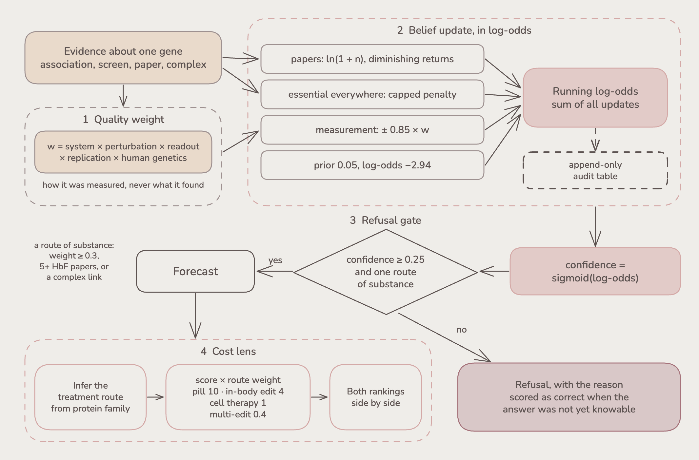
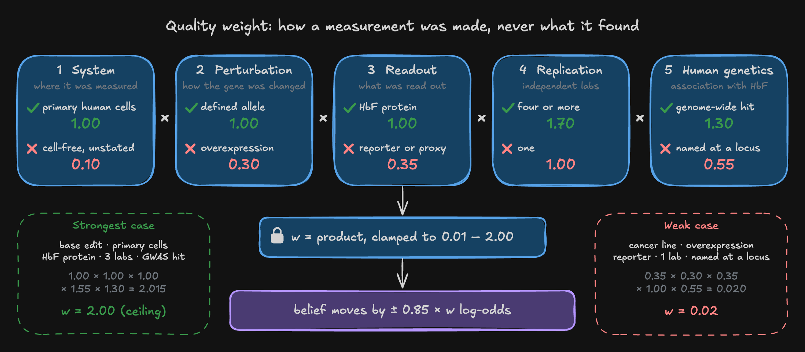

# Methodology

Two things in this system assign numbers that are not measurements: the method
signature, which decides how much a measurement is worth, and the belief
reviser, which decides how much a measurement moves a claim. Both are stated
policies. Neither is fitted to anything. This file gives the reason for every
coefficient.

Both were frozen before the first evaluation run and committed under a git tag.
The commit timestamp is the evidence that they were not tuned against the
answers. Where a choice was made with a known case in view, the text says so.

| Section | Answers |
| --- | --- |
| [Method signature](#method-signature) | How much is one measurement worth? |
| [Belief revision](#belief-revision) | How far does it move a claim? |
| [Refusal](#refusal) | When is a claim reported? |
| [Traps](#traps-and-what-each-family-actually-measures) | What does each trap family measure? |
| [Cost lens](#cost-lens) | How does treatment route change the ranking? |
| [Bootstrap intervals](#bootstrap-intervals) | How wide is each metric's uncertainty? |
| [Language-model track](#language-model-track) | How is the model asked, grounded and replayed? |
| [Temporal holdout](#temporal-holdout-as-a-complementary-contamination-control) | What does the time split verify? |
| [Disclosure](#disclosure-what-changed-after-the-answer-key-was-visible) | What changed after the answer key was visible? |

## Method signature

The module is `src/hindcast/agents/method_signature.py`. It reads how a
measurement was produced and returns a weight. It never reads what the
measurement concluded. Two screens run identically in the same system, one
finding a strong effect and one finding nothing, receive the same weight.

Five terms, combined multiplicatively and then clamped.

### Why multiplicative

These are not independent contributions that add up. A direct HbF protein
readout, measured in a cell line that does not perform the fetal-to-adult
globin switch, is not worth the sum of its parts. A weak system has to discount
everything measured in it, and multiplication is what does that. Under addition,
a perfect readout would partly rescue a meaningless system, which is the error
this term exists to prevent.

### Term 1: the system

| System | Weight |
| --- | --- |
| Human population, meaning a genetic association measured in people | 1.00 |
| Primary human CD34+ HSPCs, erythroid differentiated | 1.00 |
| Human erythroid progenitor line, HUDEP-2 class | 0.75 |
| Human cancer line, K-562 class | 0.35 |
| Human immortalized line, not erythroid | 0.30 |
| Mouse model, in vivo | 0.30 |
| Mouse cell line | 0.20 |
| Non-human other | 0.10 |
| Cell-free, or the source does not say | 0.10 |

Primary human CD34+ cells differentiated down the erythroid pathway perform the
fetal-to-adult switch that the disease is about. HUDEP-2 is an immortalized
human erythroid progenitor line that also performs the switch, so it sits close
behind. K-562 is an erythroleukemia line that expresses fetal and embryonic
globins and never silences them. A result showing more HbF in K-562 may
therefore be showing nothing about silencing at all, which is why the gap
between 0.75 and 0.35 is the largest in the table.

A mouse carries a different globin locus with a different developmental switch.
The cases where mouse and human globin regulation disagree are the reason this
term dominates the others.

Human population is placed at the top, level with primary human cells, because
a genetic association is measured in the only system that has to work. It is
not placed above them, because an association identifies a locus rather than a
mechanism, and the penalty for an unresolved causal gene is applied separately.

### Term 2: the perturbation

| Perturbation | Weight |
| --- | --- |
| Base edit, or knock-in of a defined allele | 1.00 |
| Naturally occurring human genetic variant | 1.00 |
| CRISPRi | 0.85 |
| CRISPRa | 0.70 |
| Nuclease knockout | 0.70 |
| RNAi | 0.40 |
| Overexpression | 0.30 |
| The source does not say | 0.35 |

A defined allele is the strongest perturbation available, because the sequence
change is known and its consequence can be reasoned about. A natural human
variant is equally strong for a different reason: it is the experiment that has
already been run at population scale, in the right species, without a vector.

CRISPRi represses transcription without cutting, so it avoids both the indel
heterogeneity of a pooled knockout and the DNA damage response that a cut
provokes. It is incomplete, which is why it is not at 1.00, but it is cleaner
than a knockout and is placed above it.

Overexpression is weakest. Forcing a factor above its physiological range
routinely produces effects that do not occur at native levels, and the globin
regulation literature contains several findings of that kind that did not hold.

"The source does not say" is set at 0.35, below knockout. An unstated method is
treated as somewhat worse than the most common method, because the cases where
authors do not state it are not a random sample of the cases where they do.

### Term 3: readout directness

| Readout | Weight |
| --- | --- |
| HbF protein, or F-cell percentage | 1.00 |
| HBG1/HBG2 transcript | 0.65 |
| Reporter, sorted population, or other proxy | 0.35 |

The endpoint that matters clinically is HbF protein per red cell and its
distribution across cells, because a given mean HbF protects far better when
spread evenly than when concentrated in a few F-cells.

Transcript is one step removed, and the step is not free. Gamma-globin mRNA and
HbF protein come apart through translational control. That is not a hypothetical
concern here: translational control is the mechanism the EIF2AK1 result turns
on, and a system that treated mRNA and protein as interchangeable would be
blind to the class of finding this benchmark is built around.

### Term 4: independent replication

| Independent laboratories | Multiplier |
| --- | --- |
| 0 or 1 | 1.00 |
| 2 | 1.35 |
| 3 | 1.55 |
| 4 or more | 1.70, capped |

Replication by the same group in the same system is close to free and is not
counted. Replication by an unrelated group is the most informative thing that
can happen to a finding.

The multiplier saturates because the fourth independent replication adds less
than the second. It is capped so that no amount of replication can rescue a
weak system: the cap of 1.70 is smaller than the ratio between the strongest and
weakest system weights, so replication can never promote a mouse cell line
result above a primary human cell result.

### Term 5: human genetic support

| Condition | Multiplier |
| --- | --- |
| Genome-wide significant association to the HbF trait family | 1.30 |
| No such association | 1.00 |
| Gene is the author-reported gene at an associated locus | 0.55 |

The bonus is deliberately smaller than the system term. A genetic association
says that a gene matters. It does not say that a particular cell-line
experiment about that gene was well done.

The penalty is the geometry problem in its statistical form. A GWAS peak names
a region, and the author-reported gene at that region is an assignment made by
the study's authors, not a result. The standing example is in this repository's
own data: the olfactory receptor genes OR51B5 and OR51B6 are reported genes at
an HbF-associated locus with an association p-value of 3e-08, and they have no
plausible role in globin regulation. Without this penalty, a system reading the
GWAS Catalog would rank olfactory receptors as HbF regulators. The adversary
plants exactly that trap, and the penalty is why the system survives it.

### Clamping

The product is clamped to the range 0.01 to 2.00. The floor exists because
nothing in this corpus is worth exactly nothing, and a weight of zero would make
a measurement unable to move any belief even in principle. The ceiling exists so
that no single measurement dominates an accumulation.

The ceiling does bind. A base edit in primary human CD34+ cells with a protein
readout, three independent replications and genetic support computes to 2.015
and is clamped to 2.00. Information is lost there, and it is worth saying so
rather than pretending the range was chosen wide enough.

### Assay standing

A modifier for sources whose rows are not experiments in the usual sense. An
Open Targets text-mined literature co-mention is a statement that two terms
appeared in the same article. It is the weakest evidence in the corpus at 0.25.
An animal model row sits at 0.60. Genetic association, clinical, screen and
gene-effect rows are at 1.00, because their standing is already carried by the
five terms above and applying a second discount would double-count.

## Belief revision

The module is `src/hindcast/agents/belief_reviser.py`. No language model decides
any numeric update. The rule is log-odds accumulation.

Each claim carries a confidence in the open interval 0 to 1, held internally as
log odds. Each piece of evidence contributes

    delta = direction * weight * EVIDENCE_STRENGTH

where `direction` is +1 for support and -1 for contradiction, `weight` is the
method signature weight, and `EVIDENCE_STRENGTH` is a single global constant
converting a unit weight into log-odds. Evidence is applied in publication-date
order, and every application writes an immutable audit row recording the claim,
the prior, the posterior, the triggering record and the weight applied.

### Why log-odds

Log-odds accumulation is the form Bayesian updating takes when independent
pieces of evidence are combined, and it has the properties this problem needs.
Confidence cannot leave the interval however much evidence arrives. Evidence
order does not change the final value, which matters because publication order
is partly an accident of review times. And the audit row is legible: a reader can
see that one measurement moved a claim by a stated number of log-odds and can
check the arithmetic.

### The prior

Every claim starts at a confidence of 0.05, which is log-odds of about -2.94.
The prior is deliberately low and it is the same for every claim, because a
per-claim prior would be the place where knowledge of the answers could enter
without being visible. A uniform sceptical prior means a claim only rises
because evidence raised it.

### The strength constant

`EVIDENCE_STRENGTH` is 0.85 log-odds per unit weight. It sets how fast beliefs
move, and its value determines calibration more than any other single number
here.

The value was chosen so that the strongest available single measurement, at
weight 2.00, moves a claim from the 0.05 prior to 0.224, which is below the
refusal threshold of 0.25. One measurement, however good, cannot make a claim
reportable. Five measurements at weight 1.00 reach 0.787, and the sequence from
the prior runs 0.110, 0.224, 0.403, 0.612, 0.787. That is the behaviour wanted:
no single screen establishes a therapeutic claim, and agreement between several
independent measurements does.

It was not tuned against the evaluation. The calibration results reported in the
README are what this value produces, including where they are poor.

### Literature evidence is logarithmic, not linear

Publications are not independent experiments. Two hundred papers co-mentioning
BCL11A with fetal hemoglobin are two hundred correlated observations of one
literature, and an earlier version of this module treated each as an independent
update. The result was a confidence of 1.000 for any well-studied gene, which is
not a calibration problem so much as a category error: a pile of citations
became certainty.

A claim's entire literature therefore contributes

    LITERATURE_SCALE * ln(1 + number of HbF-specific publications)

with `LITERATURE_SCALE` at 1.0 log-odds. Each publication still writes its own
audit row, ordered by date: the k-th contributes the difference between ln(1+k)
and ln(k), so the rows sum to exactly the total above, the earliest paper
carries the largest increment, and the timeline still shows belief accumulating
as the field published. A record naming only the erythroid context rather than
HbF gets a quarter of the increment, because working in the right tissue is
weaker evidence than working on the trait.

The resulting curve, from the 0.05 prior:

| HbF-specific publications | Confidence |
| --- | --- |
| 1 | 0.095 |
| 3 | 0.174 |
| 5 | 0.240 |
| 10 | 0.367 |
| 20 | 0.525 |
| 50 | 0.729 |
| 100 | 0.842 |
| 200 | 0.914 |

A gene the field has written two hundred HbF papers about ends up believed and
not certain. A gene with three stays below the refusal threshold.

### Essentiality is bounded the same way, on the other side

The same correction applies to the negative side of the ledger, and it was
needed for the same reason.

The pre-2018 slice holds 26,171 fitness readouts. A pan-essential gene is hit in
most of the screens that tested it, so applying one independent negative update
per readout gave genes like CHD4 around 400 negative updates and drove their
confidence to exactly 0.000. Three of the genes that happened to are in the
answer key. Those 400 screens are not 400 experiments; they are one fact about
the gene, measured 400 times in different cell lines.

So essentiality now contributes a bounded total. Each screen keeps its own
audit entry and its own provenance, the per-screen increments are harmonic in
the same way as the literature increments, and the whole sequence is normalised
to sum to:

    ESSENTIALITY_CEILING * fitness_hit_fraction

with `ESSENTIALITY_CEILING = 1.20` log-odds. A gene essential in every screen
that tested it loses the full 1.20. A gene essential in 70% of them, which is
the pan-essential threshold, loses 0.84.

The ceiling is set so that pan-essentiality roughly cancels the support of three
HbF-specific publications. It is deliberately not larger. Essentiality argues
that a gene is not a usable target, and the cost lens already records that
separately as `NOT_THERAPEUTIC`. It is not an argument that the gene has no
effect on HbF, and a coefficient large enough to annihilate the belief would be
making that second, stronger claim on the strength of a fitness screen.

### The composition route

`ACTS_THROUGH` is the only route that can reach a gene the pre-cutoff literature
does not write about, which is the case the benchmark is about. It is derived
from HGNC gene groups whose names end "complex subunits", which assert that the
members are subunits of one protein complex.

Structural domain groups are not used. "Zinc fingers C2H2-type" and "BTB domain
containing" assert a shared fold, not a shared mechanism, and they run to
hundreds of genes, so an edge drawn from them would be noise with a provenance
row attached.

Two restrictions keep the route from manufacturing claims. The partner's support
must be a *measurement*, because transferring a co-mention count through a
complex would turn one weak signal into several. And there is one axiom per
gene, from its single strongest partner, because subunits of a complex are
studied together and are not independent observations.

A partner's strongest measurement transfers at `COMPOSITION_DISCOUNT = 0.35`,
and the resulting weight must reach `MIN_COMPOSITION_WEIGHT = 0.25` to make a
claim reportable by this route. A third is the stated allowance for the fact
that a complex contains subunits that carry its function and subunits that do
not, and co-membership does not say which is which.

**This route fires zero times at the primary slice.** No measurement-backed
partner sits in any curated complex at 2017, because every HbF-family
measurement in that slice is a genetic association at the globin locus, at
BCL11A, at MYB or at HBS1L, and none of those genes shares a curated complex
with another gene in scope. Five of the thirteen ground-truth genes at that
slice are NuRD subunits, so a rule admitting literature-established partners
would have reached several of them. That is recorded here rather than acted on;
see the disclosure at the end of this document.

### Contradiction and supersession

A contradiction subtracts. It does not zero a claim, because a failure to
replicate is itself a measurement made in a system with its own weight, and a
weak contradiction of a strong claim should move it a little.

Supersession is separate from contradiction and does not subtract. When a
claim is refined rather than refuted, for example from "gene X affects HbF" to
"gene X affects HbF solely through gene Y", the earlier claim was coarse and not
wrong. The `SUPERSEDES` edge records the refinement and the earlier claim keeps
its confidence.

## Refusal

Refusal is a scored outcome, and the threshold is a policy.

A claim is reported as a forecast only if its confidence reaches 0.25 and it has
evidence of substance behind it. Evidence of substance means either of two
routes:

*   one supporting measurement with a method signature weight of at least 0.30,
    meaning a genetic association or a functional result in a system that
    matters; or
*   at least five publications naming the gene together with fetal hemoglobin
    specifically.

Two routes rather than one, because the open record contains both kinds of
evidence and recognising only the first makes the system unable to say anything
at all. There are almost no open, dated, redistributable functional HbF
measurements, as DATA_SOURCES.md and LIMITATIONS.md set out, so a
measurement-only rule refuses every gene and the benchmark measures nothing.

What neither route admits is a claim resting on a handful of co-mentions. Five
HbF-specific publications is a stated threshold, frozen with the rest, and the
logarithmic literature rule above means five of them only reach a confidence of
0.240, so a gene needs a little more than the bare minimum on both counts
before it is reported.

Below the threshold the system returns a refusal naming what is missing, not a
low-confidence guess. The refusal is graded: on questions whose answer genuinely
postdates the cutoff, a refusal is correct and scores.

## Traps, and what each family actually measures

The adversary plants four families and they do not all measure the same thing.
Reporting them as one number would hide that, so the scorecard separates them.

**Judgement traps.** `association_without_function` and `pan_essential`. These
ask whether the system would endorse a gene it should reject. A gene with a
strong statistical association and no function, or a gene whose loss kills the
cell, appearing in the top ten of either ranking is a failure. These are the
rows a reader should look at, because passing them requires the weighting and
the essentiality logic to work.

**Contamination traps.** `postdates_cutoff`. A gene whose role was established
after the cutoff and for which the slice holds fewer than three HbF-specific
publications and no HbF measurement. Under the refusal rule such a gene cannot
be reported, so the system passes these by construction. That is stated rather
than presented as an achievement. What a pass shows is that the time slice held:
had post-cutoff evidence leaked in, the gene would have support and would be
forecast. A failure here would mean the benchmark's central claim was void.

Two consequences follow and both are reported.

A gene can be a correct refusal and a missed forecast at once. ZNF410 at the
2017 cutoff is the case: the pre-cutoff record holds two publications naming it,
neither about globin, so refusing is correct, and the field established its role
in 2020, so the ranking missed it. Forcing one label would lose half the
information. The scorecard names the genes in both sets.

A trap whose correct answer is "reject" passes for free when the forecast is
empty. The grader marks those passes vacuous and reports
`traps_passed_meaningfully` separately, so a system that refuses everything
cannot appear to have avoided every trap.

The threshold for "no pre-cutoff evidence" is three HbF-specific publications,
deliberately below the reportability threshold of five. The gap between them is a
band where a gene is neither clearly forecastable nor clearly unanswerable, and
genes in that band are not made into traps at all rather than being forced into
one category.

## Cost lens

The module is `src/hindcast/cost.py`, and its reasoning has to be makeable from
pre-T information or it is useless inside a forecast. It therefore uses two
pre-T facts: the protein class, taken from the HGNC gene family, and whether the
effect is exerted through a cis-regulatory element. Both were knowable decades
before any slice used here. Nothing in that module reads a tractability
annotation or a drug database, because those reflect what is known now.

The route weights are 10.0 for a small molecule, 4.0 for an in vivo edit, 1.0
for a single ex vivo edit, 0.4 for a multi-edit ex vivo product and 0.0 for
mechanistic insight implying no route. The gaps are chosen so that a moderately
confident small-molecule claim outranks a highly confident multi-edit claim,
which is the reordering the lens exists to produce. The anchors are the
approved products: Casgevy at about $2.2M and Lyfgenia at about $3.1M, neither
including the required inpatient stay, both requiring apheresis, GMP
manufacturing and myeloablative conditioning
([BioPharma Dive, December 2023](https://www.biopharmadive.com/news/crispr-sickle-cell-price-millions-gene-therapy-vertex-bluebird/702066/)).

One ordering decision inside that module was made with a known case in view,
and it should be stated plainly. The cis-element check runs before the complex
check. BCL11A is listed by HGNC among BAF complex subunits, which would score it
as the most expensive route, while the approved therapy disrupts its erythroid
enhancer with a single edit. The ordering follows the established pathway rather
than the complex annotation. That is a judgement informed by knowing what was
approved, it is not derived from the pre-T record, and a reader should weigh it
as such.

## Bootstrap intervals

Each slice has between 3 and 19 ground-truth genes, so a precision of 0.20 is
one gene. Precision at 5, the reciprocal rank of the first hit (reported as
MRR) and, for language-model rows, the grounded-claim rate each carry a 95%
percentile bootstrap interval, computed by `src/hindcast/bootstrap.py`.

The resampled unit is the gene. For a ranking the units are the genes the
question covered: those ranked, those refused and those in the ground truth.
Each resample draws as many genes as there are units, with replacement, keeps
the drawn genes in their ranked order (a gene drawn twice takes two adjacent
places) and scores the result as the ranking was scored. For the grounded-claim
rate the units are the claimed genes. The interval runs from the 2.5th to the
97.5th percentile of the resampled values by nearest rank, so each bound is a
value some resample produced.

| Constant | Value | Reason |
| --- | --- | --- |
| `RESAMPLES` | 2000 | Enough that the percentile bounds are stable to the second decimal for metrics that take a handful of distinct values. |
| `LEVEL` | 0.95 | The conventional level. |
| `SEED` | 20171231 | The project's fixed seed. Each interval starts its own generator from it, so intervals replay exactly. |

The interval describes how much the metric depends on which genes happened to
be in the question. It does not cover error in the answer key, and with 3
ground-truth genes it is wide because 3 genes say little. No model is called
again: a language-model row's interval is over the genes of its one committed
answer and says nothing about how a second response would differ.

## Language-model track

A language model is asked the same question as the rule-based system, on the
same slices, and its answer is scored by the same grader. The code is
`src/hindcast/llm/`. The rule-based system does not use it.

### What the model is asked

The prompt (`SYSTEM_PROMPT` and `TASK_PROMPT` in `llm/forecaster.py`) gives the
cutoff date and the candidate genes: the scope genes in `scope.py`, minus those
whose role the rule book dates before the cutoff. The rule-based forecaster is
told the same set of already-established genes. For each candidate the model
either claims it, with a confidence, the IDs of the evidence rows it relies on
and a one-sentence rationale, or refuses it with a reason. The model never
receives the rule book's establishing records or the traps; the traps are built
after it has answered.

The retrieval condition sets what evidence the prompt carries. In `none` it
carries no evidence, so the row measures what the model answers from its
training alone. In `text` it carries publication titles retrieved from the
slice. In `graph` it carries no rows and the model is given tools that query
the slice. Both are described next.

### Text retrieval

Code: `src/hindcast/llm/retrieval.py`. For each candidate gene, two rankers
search the titles of the publications in the slice, and their results are fused.

- **Lexical.** BM25 over an FTS5 index of titles. The query is the gene symbol,
  so this ranker returns titles that name the gene.
- **Dense.** Cosine similarity between a query sentence (`DENSE_QUERY`, which
  names the gene and the phenotype) and a vector for each title. The search is
  exact; [Design decisions](#design-decisions) gives the reason.
- **Fusion.** Reciprocal rank fusion: a title scores 1 / (`RRF_K` + rank) under
  each ranker that returns it, and the scores are summed. Ties are broken by ID.

Both indexes live inside the slice database. The title index is built during
materialization from the publication rows the slice already holds. Vectors are
computed once per title into a local cache, and the slice copies only the
vectors of publications it contains. A post-cutoff title therefore has no index
entry and no vector in the slice, and `tests/test_slice_leak.py` asserts both.

The prompt lists each retrieved row as its node ID, publication date and title,
under the gene it was retrieved for. Only titles are searched and shown: the
repository commits no abstracts or article text.

The ranked IDs for each cutoff are committed as a retrieval record in
`eval/model_cache/retrieval/`. A run replays the record, reading each ID back
through the slice connection, and stops with an error if the slice does not hold
one. The embedding model is therefore needed to write a record and not to
replay one. With no record the row is `not_run`; there is no fallback to the
lexical ranker alone.

The symbol-only lexical query does not match a title that uses an alias, and a
symbol that is also a common word or abbreviation can match unrelated titles.
The row measures retrieval as specified here, with those limits.

### Graph tools

In the `graph` condition the model queries the slice itself, through five tools
defined in `llm/tools.py`:

| Tool | Returns |
| --- | --- |
| `gene_evidence_summary` | Counts for one gene: publications naming it, measurements by assay, complex partners. |
| `gene_measurements` | Measurements for one gene, most recent first: ID, date, assay, data source, phenotype, value. |
| `gene_publications` | Publications naming one gene, most recent first: ID, date, title. |
| `complex_partners` | Genes joined to one gene by an `ACTS_THROUGH` edge, with the complex they share. |
| `genes_by_publication_count` | The candidate genes ranked by the number of publications naming them. |

A tool takes a gene symbol or nothing. None takes a date, a path or a query, so
no argument can ask for a later row, and each runs on the slice connection,
which holds no row dated on or after the cutoff. Every result names its rows by
node ID, and the union of the IDs a run was shown is recorded as its context.
A result holds at most `ROWS_PER_TOOL_RESULT` rows and states the total.

The run is a loop. Each model turn is one request through the replay cache, and
each tool call in the response is answered from the slice and sent back. A tool
result is a deterministic function of the slice, so replaying the first
committed response rebuilds the second request exactly, and the loop replays
offline. If any turn is missing from the cache the whole row is `not_run`.

The model may make `TOOL_CALL_BUDGET` calls. A call past the budget is not run:
the model is told the budget is spent and must answer. A call that names an
unknown gene or tool is returned to the model as an error and counts against
the budget. A model that is still calling tools after `MAX_MODEL_TURNS` turns
is recorded as `failed`. Every call is written to the result and the trajectory
with its arguments, its outcome and the IDs it returned.

The model chooses whether to call a tool. The API rejects a forced tool choice
for the pinned model, so a run in which the model calls no tool is possible and
is reported with zero calls.

### What counts as an answer

The response must parse into the answer schema (`ModelAnswer`). A response that
does not parse, is refused, is cut off at the output limit, has a confidence
outside 0 to 1, or answers the same gene twice is recorded with the status
`failed` and its reason. It is not repaired and not retried. A request with no
committed response and no live call is `not_run`. Only `ran` rows have a
scorecard.

Gene names in the answer are resolved through the slice exactly as ingested
records are, so an alias is graded as the gene it names.

### Grounding

Grounding asks whether a claim rests on evidence the model was given. It is
computed by `llm/grounding.py` from the run record, after grading, with no
model involved. The grader does not read it.

| Term | Definition |
| --- | --- |
| Valid citation | A cited ID the slice holds. |
| In-context citation | A valid citation that was also among the rows or tool results the model received. |
| Out-of-context citation | A valid citation the model was not shown. |
| Post-cutoff citation | A cited ID the slice lacks and the full store holds: a row dated on or after the cutoff. |
| Fabricated ID | A cited ID that no store holds. |
| Grounded claim | A claim that cites at least one in-context evidence row that names its gene. |

An evidence row is a measurement or a publication. A measurement names the
gene it was recorded for. A publication names a gene that ingest matched to it,
or whose approved symbol stands as a word in its title. A gene's reference
node carries no evidence, so citing it alone grounds nothing.

Three rates are reported per run, each as a numerator and a denominator:
citation validity (valid citations over all citations), in-context citations
over all citations, and the grounded-claim rate (grounded claims over all
claims). Post-cutoff and fabricated IDs are listed.

What the grounded-claim rate does not say: that the cited row supports the
claim. A title that names a gene grounds a claim about that gene whatever the
title reports. The rate is a lower bar than entailment, chosen because it can
be checked without a judge model. In the `none` condition the model is shown
nothing, so no claim can be grounded and the rate is 0 by construction.

### Memorization signal

A claim is *recalled* when its gene's role was established on or after the
cutoff, by the frozen rule book, and the claim is not grounded. The claim is
correct and cites nothing the model was shown that names the gene, so the
evidence given does not account for it. `llm/memorization.py` lists the recalled
claims of each run and reports them over the run's post-cutoff claims. It also
lists the postdates-cutoff traps the forecast failed: genes it claimed although
the slice holds no evidence for them.

The `none` condition is the reference. The model is shown nothing there, so
every post-cutoff gene it claims is recalled. A retrieval condition is read
against it: the same gene claimed in `text` or `graph` with a grounded citation
is no longer counted as recalled, which shows that pre-cutoff evidence naming
the gene was available and cited, and does not show that the model relied on it.
[LIMITATIONS.md](LIMITATIONS.md#the-memorization-signal-is-a-lower-bound) states
what the signal cannot detect.

### Conventions that differ from the rule-based rows

- **Refusals enter calibration at 0.** The model gives a reason for a refusal
  and no number. The grader computes the calibration error over claims and
  refusals together, so a model refusal is entered with confidence 0. A refused
  gene that the field later established therefore counts against calibration in
  the lowest bin.
- **No cost lens.** The model is not asked for a therapeutic route. Every item
  carries the same route and both rankings are identical, as for the flat
  literature baseline.

### Fixed parameters

| Constant | Value | Reason |
| --- | --- | --- |
| `DEFAULT_MODEL_ID` | `gemini-3.8-flash` | One pinned model for every committed row. The ID is part of the cache key and is written into each result, with the model ID the API reports having served. |
| `THINKING_LEVEL` | `medium` | Set explicitly so a change in the provider's default cannot change a result. No sampling parameters are sent. |
| `MAX_OUTPUT_TOKENS` | 32000 | Covers thinking and a full answer over the candidate list; the provider counts thinking against this limit. Raised from 16000 before any graded model result existed: the first live request (2014 cutoff, no retrieval) used 15,102 tokens on one attempt and reached the limit at 15,985 on the next. A response that reaches the limit is a failure. |
| `REQUEST_TIMEOUT_SECONDS` | 1800 | Wall-clock limit for one live call. The slowest completed call in the first live runs took 26 minutes. Transport only: not part of the cache key, and a call that exceeds it is re-run, never recorded. |
| Transport retries | 4 | The SDK default (google-genai 3.3), for connection errors and HTTP 408, 409 and 5xx only. An invalid answer is never retried. |
| `RETRIED_HTTP_STATUSES` | 408, 409, 500, 502, 503, 504 | The SDK's retried statuses without 429. On a quota error the SDK waits as long as the provider asks, which at the free tier's limit of 20 requests a day was 21 hours. A 429 stops the run instead, and a later run resumes from the cached turns. |
| `EMBEDDING_MODEL` | `BAAI/bge-small-en-v1.5` | A small open model (MIT license, 384 dimensions) that runs locally on a CPU through fastembed, so computing retrieval sends no data to a third party and needs no key. |
| `RRF_K` | 60 | The constant from the paper that introduced reciprocal rank fusion (Cormack, Clarke and Büttcher, SIGIR 2009). Not tuned here. |
| `RANKER_DEPTH` | 50 | Rows each ranker contributes per gene before fusion. Ten times the rows kept, so a row needs a high rank under one ranker or a moderate rank under both. |
| `ROWS_PER_GENE` | 5 | Fused rows per gene in the prompt. Keeps the evidence for all candidates in one request. |
| `TOOL_CALL_BUDGET` | 40 | Tool calls per run. About one per candidate gene at the 2017 cutoff (41 candidates), so the model can look at every gene once or at fewer genes in depth, and the cost of a run is bounded. Set before any live run. |
| `ROWS_PER_TOOL_RESULT` | 20 | Rows per tool result. Bounds the size of each request; the total is always stated. |
| `MAX_MODEL_TURNS` | 42 | `TOOL_CALL_BUDGET` + 2: every turn before the budget is spent uses at least one call, one further turn is told the budget is spent, and one must answer. |
| `PRICES_USD_PER_MILLION_TOKENS` | 0.75 input, 3.75 output | Paid-tier list price for the pinned model on the days the rows were run (November 2026). Thinking tokens are counted and priced as output. `cost_usd` is input and output tokens at these prices; the rows were run on the provider's free tier, which billed nothing. |

### Replay

Every call goes through the cache in `eval/model_cache/`, keyed by the SHA-256
of the whole request. [eval/model_cache/README.md](eval/model_cache/README.md)
gives the format. Responses are not deterministic at the API, so the committed
response is the result: a second live run could differ, and the cache is what
makes the reported row reproducible.

### Design decisions

Each choice follows from the hard rules in
[CONTRIBUTING.md](CONTRIBUTING.md): the slice database enforces the cutoff,
every number traces to a source row, and a clone reproduces every result
offline.

| Decision | Alternative | Why the alternative was not chosen |
| --- | --- | --- |
| Exact vector search: the query is compared with every title vector in the slice. | An approximate nearest-neighbour index. | A slice holds few enough titles that exact search is fast. An approximate index would add a recall parameter to tune and report, and results that can vary with how the index was built. |
| The title index and the vectors live inside the slice database. | One index over all titles, filtered by date at query time. | A date filter is calling code, and a missing or wrong filter returns post-cutoff rows. Inside the slice a post-cutoff title has no index entry and no vector, so there is nothing to filter, and the leak tests cover retrieval like any other read. |
| A small open embedding model that runs locally. | A hosted embedding API. | Computing retrieval sends no data to a third party and needs no key. The ranked IDs are committed, so a clone replays retrieval without the model at all. The cost is a smaller model than the hosted ones. |
| Tools that query the existing evidence graph. | GraphRAG, in which a language model extracts entities and relations from text to build the graph. | The graph here is built from curated sources, and every node carries its source and date. Extracted nodes would have no source row, and a model trained after the cutoff could write later knowledge into a graph that is supposed to predate it. The repository also commits titles only, so there is no article text to extract from. |

## Temporal holdout as a complementary contamination control

The idea for this project came from
[Cortex Bio](https://cortexbiolabs.com) and their July 2026 case study,
[Designing molecules that have never been made](https://cortexbiolabs.com/post/designing-molecules-that-have-never-been-made).
The post says its source "is a published 2024 paper that a frontier model has
very likely seen in training", and describes two controls:

- They ran the task twice, "once with the real names, and once with every
  compound, warhead, and ligand replaced by an anonymous token", and compared
  the scores.
- They "froze a rule book of the governing trends, checked against the table,
  before any model ran".

This project follows that design. Its answer key is a rule book frozen before
the first evaluation run, as in the second control, and it adds a temporal
holdout as a third control aimed at the same problem from the data side. The
controls are complementary: a temporal holdout constrains which evidence can
reach the reasoning, and token replacement constrains what the model can
recognize in that evidence. Neither replaces the other.

What a temporal holdout verifies:

- **No evidence dated on or after the cutoff T reached the reasoning.** This is
  a property of the data layer. The repository materializes a separate database
  holding only pre-T rows and serves it over a connection that cannot attach
  anything else. `tests/test_slice_leak.py` attempts the leak by every route and
  asserts each one fails.
- **The answer key was fixed before any result existed.** What the field
  published after T is recorded in `eval/rulebook/` by a stated rule, frozen at
  the tag
  [`rulebook-frozen-v1`](https://github.com/sharduldhaul/crispr-hindcast/tree/rulebook-frozen-v1),
  which predates the first commit with evaluation results.

What it does not verify:

- **What the reader already knows.** The holdout controls the evidence, not the
  reader. A language model placed in this pipeline may have read the 2018 result
  in training, and no data-layer enforcement can remove that.
  [LIMITATIONS.md](LIMITATIONS.md) covers this.
- **That a description no longer identifies its subject.** That is the question
  token replacement addresses, and this project does not test it.

This is an independent project that builds on a problem Cortex Bio named and
on the controls they described. It is not a reimplementation of their product
and makes no claim about it.

## Disclosure: what changed after the answer key was visible

The rule book was frozen and tagged `rulebook-frozen-v1` before the scored runs,
and the commit timestamp is the evidence. A timestamp is not enough, because
the code was still being fixed while the ground-truth gene list was on screen.
What follows is every change made in that window and why none of it is tuning.

Four defects were found by rebuilding the graph on the complete literature
corpus, after the answer key existed. All four were wrong on their own terms,
independently of any score:

1.  `matched_tiers` was never written onto publication nodes, so no consumer
    could tell an HbF record from an erythroid one. The forecast was empty and
    every gene was refused. This was an absent field, not a judgement.
2.  Publication support trusted the full-text retrieval tag, which credited
    EIF2AK1 with thirty pre-2018 HbF records of which about three concerned the
    gene; the rest included a Bacillus strain and a dairy cattle guideline.
    Requiring the title to name the gene *reduced* EIF2AK1's support from 30 to
    2, which moved it further from being forecast, not closer.
3.  `gene_by_symbol` resolved HBG1 to ACSBG1, an acyl-CoA synthetase that lists
    `hBG1` as an alias, because ties were broken by string-sorted identifier.
    Fixing it removed a gene from the forecast and lowered the item count from
    three to two.
4.  Essentiality applied one independent update per fitness screen and zeroed
    every pan-essential gene. Fixing it left the forecast and every ranking
    metric unchanged and improved ECE from 0.206 to 0.199.

Two of the four lowered the score. Two left the forecast untouched. None was
made by looking at whether a ground-truth gene moved.

The composition route is the case where the temptation was real and is worth
being explicit about. It was specified and implemented on the reasoning in this
document, and it produces nothing at the primary slice. Only afterwards was it
apparent that five of the thirteen ground-truth genes at that slice are NuRD
subunits, and that admitting literature-established partners instead of
measurement-backed ones would have reached several of them. That change was not
made. There is no principled coefficient for transferring a co-mention count
along a complex edge, and the only argument available for making the change was
that it would have improved the score. The route is reported as firing zero
times.

The same applies to the refusal threshold. LIN28B and HDAC2 both land at
confidence 0.240 against the frozen 0.25, on five HbF publications each. Moving
the threshold to 0.24 would have forecast two more correct genes. It was not
moved.

The general shape of the rule for anyone extending this: a change that makes a
number wrong into a number right is a fix, and it stays even when it costs
score. A change that makes a defensible number into a different defensible
number, chosen because of where the answers are, is tuning, and it does not go
in.
