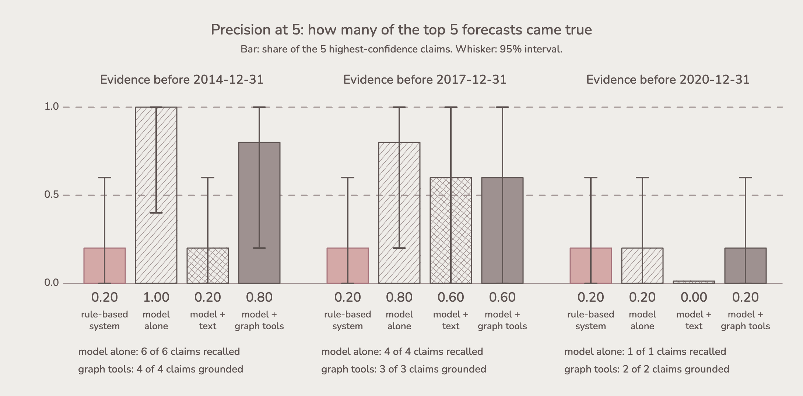

# CRISPR HINDCAST

[](https://github.com/sharduldhaul/crispr-hindcast/actions/workflows/ci.yml)
[](https://codespaces.new/sharduldhaul/crispr-hindcast)

A benchmark that tests whether a system can forecast scientific discoveries
from past evidence alone, built so that a correct answer cannot come from
leaked data or a tuned answer key.

Read every result at
[crispr-hindcast.vercel.app](https://crispr-hindcast.vercel.app), with nothing
to install. That copy is read-only; to re-run the pipeline,
[launch the app](#launch-the-app) locally or in Codespaces.

## The problem

When an AI system "predicts" a scientific result, it may only be repeating it.
Language models are trained on the published record, so a test built from
published findings cannot separate forecasting from recall. A high score is
then not evidence of reasoning, and most evaluations give no way to tell.

## The solution

A hindcast: pick a cutoff date T, remove every piece of evidence dated on or
after T, ask for a forecast, and grade it against what the field published
after T.

The test case is fetal hemoglobin, a therapeutic route for sickle cell disease:
which genes controlling it would the field establish next? Two forecasters
answer at three cutoffs (2014, 2017, 2020): a rule-based system with no
language model, and a language model (`gemini-3.8-flash`) as the comparison.


### How it solves the problem

Each way a forecasting test can be fooled has a control that is enforced by
code and checked by a test.

| Failure | Control | Checked by |
| --- | --- | --- |
| Later evidence leaks into the reasoning | Each cutoff gets its own database holding only earlier rows, served over a connection that can attach nothing else | `tests/test_slice_leak.py` |
| The answer key is tuned to the result | The answer key and every threshold were frozen and tagged ([`rulebook-frozen-v1`](https://github.com/sharduldhaul/crispr-hindcast/tree/rulebook-frozen-v1)) before the first run | Git history |
| Guessing is rewarded | Refusal is a scored outcome, and trap questions are mixed into the candidates | `tests/test_refusal.py` |
| The model recalls the answer from training | The model runs alone, with text retrieval and with graph tools, and each claim is checked against the evidence it was given. This measures recall; it cannot remove it | [LIMITATIONS.md](LIMITATIONS.md#the-memorization-signal-is-a-lower-bound) |
| A number cannot be verified | Every number traces to a source row, and a clone reproduces every result offline, byte for byte, with no API key | `tests/test_provenance_and_license.py`, `tests/test_determinism.py` |

## Results



- **Model alone scores highest at the two earlier cutoffs, and the score is
  recall.** Given no evidence, it names genes established after the cutoff. This is the problem above,
  measured.
- **Graph tools keep most of the score and ground it.** Every claim cites a row
  the model was given, and no cited ID is fabricated in any model row.
- **The rule-based system is cautious.** Its score is low and the same at
  every cutoff, and it is the only forecaster that passes every trap at every
  cutoff.
- **Its misses are reported.** The two main findings after 2017, EIF2AK1 and
  ZNF410, were refused: the open data before 2018 holds no measurement for
  either. Two correct genes stopped just under the frozen confidence threshold,
  and the threshold was not moved.

Three cutoffs and five ranking slots give wide intervals.

<!-- SCORECARD:START -->

### Headline

| Cutoff | Forecaster | P@5 [95% interval] | Traps passed | Grounded claims | Recalled claims |
| --- | --- | --- | --- | --- | --- |
| 2014-12-31 | rule-based system | 0.20 [0.00, 0.60] | 22/22 | n/a | n/a |
| 2014-12-31 | model alone | 1.00 [0.40, 1.00] | 16/22 | 0 of 6 | 6 of 6 |
| 2014-12-31 | model with text retrieval | 0.20 [0.00, 0.60] | 21/22 | 1 of 1 | 0 of 1 |
| 2014-12-31 | model with graph tools | 0.80 [0.20, 1.00] | 18/22 | 4 of 4 | 0 of 4 |
| 2017-12-31 | rule-based system | 0.20 [0.00, 0.60] | 15/15 | n/a | n/a |
| 2017-12-31 | model alone | 0.80 [0.20, 1.00] | 11/15 | 0 of 4 | 4 of 4 |
| 2017-12-31 | model with text retrieval | 0.60 [0.00, 1.00] | 11/15 | 3 of 4 | 1 of 3 |
| 2017-12-31 | model with graph tools | 0.60 [0.00, 1.00] | 12/15 | 3 of 3 | 0 of 3 |
| 2020-12-31 | rule-based system | 0.20 [0.00, 0.60] | 9/9 | n/a | n/a |
| 2020-12-31 | model alone | 0.20 [0.00, 0.60] | 8/9 | 0 of 1 | 1 of 1 |
| 2020-12-31 | model with text retrieval | 0.00 [0.00, 0.00] | 9/9 | 1 of 1 | 0 of 0 |
| 2020-12-31 | model with graph tools | 0.20 [0.00, 0.60] | 8/9 | 2 of 2 | 0 of 1 |

- **P@5**: of the 5 highest-confidence claims, the share the field later established.
- **Traps passed**: trap questions answered correctly, over all traps at that cutoff.
- **Grounded claims**: claims that cite a row the model was given that names the gene.
- **Recalled claims**: claims for a gene established after the cutoff that cite no such row: the answer came from training, not from the evidence.

<!-- SCORECARD:END -->

Every metric, ablation and trap is in [eval/scorecard.md](eval/scorecard.md).
[LIMITATIONS.md](LIMITATIONS.md) states what each number does and does not
show.

## Launch the app

A local website that shows every result and re-runs the pipeline from the
browser. It works offline, with no API key. The Codespaces badge above opens
the same app with nothing to install.

Needs [Python 3.12+](https://www.python.org/downloads/),
[uv](https://docs.astral.sh/uv/getting-started/installation/) and
[Node.js 20.9+](https://nodejs.org/).

```bash
uv venv --python 3.12 .venv
uv pip install -e ".[dev]"
.venv/bin/hindcast build          # evidence graph from the committed snapshot
cd web && npm install && npm run dev
```

Open http://127.0.0.1:4100.

From the command line:

```bash
.venv/bin/hindcast slice --cutoff 2017-12-31   # one cutoff, about 20 seconds
.venv/bin/hindcast run-all                     # every cutoff and ablation
.venv/bin/hindcast scorecard                   # print the results table
.venv/bin/python -m pytest -q                  # the checks behind the table above
```

Model rows replay from `eval/model_cache/`. A new live run is opt-in and needs
your own key:

```bash
GEMINI_API_KEY=... .venv/bin/hindcast llm --cutoff 2017-12-31 --retrieval graph --live
```

In a codespace, set `GEMINI_API_KEY` as a
[Codespaces secret](https://docs.github.com/en/codespaces/managing-your-codespaces/managing-your-account-specific-secrets-for-github-codespaces)
instead.

## Documentation

| File | Contents |
| --- | --- |
| [ARCHITECTURE.md](ARCHITECTURE.md) | Diagrams of the system, the evaluation and the scoring; the six agents |
| [METHODOLOGY.md](METHODOLOGY.md) | Every coefficient and rule with its reason; the language-model track and its design decisions |
| [LIMITATIONS.md](LIMITATIONS.md) | What the results do not show |
| [DATA_SOURCES.md](DATA_SOURCES.md) | Sources, licenses, attributions and exclusions |
| [SCHEMA.md](SCHEMA.md) | Node and edge types |
| [CONTRIBUTING.md](CONTRIBUTING.md) | The six hard rules and how each is enforced |

## Credit

The idea came from [Cortex Bio](https://cortexbiolabs.com) and their July 2026
case study,
[Designing molecules that have never been made](https://cortexbiolabs.com/post/designing-molecules-that-have-never-been-made),
which names the contamination problem and describes two controls for it. This
project follows that design and adds a temporal holdout as a complementary
control;
[METHODOLOGY.md](METHODOLOGY.md#temporal-holdout-as-a-complementary-contamination-control)
gives the comparison. It is an independent project, not affiliated with Cortex
Bio, not a reimplementation of their product, and makes no claim about it.

## License

Code: [MIT](LICENSE). Each dataset keeps its own license, recorded on every
node and edge and listed with its required attribution in
[DATA_SOURCES.md](DATA_SOURCES.md). Only identifiers, metadata, measurements
and publication titles are committed; no article text or abstracts.

Product and company names are used only to identify them and belong to their
owners. This is research software and not medical advice.
